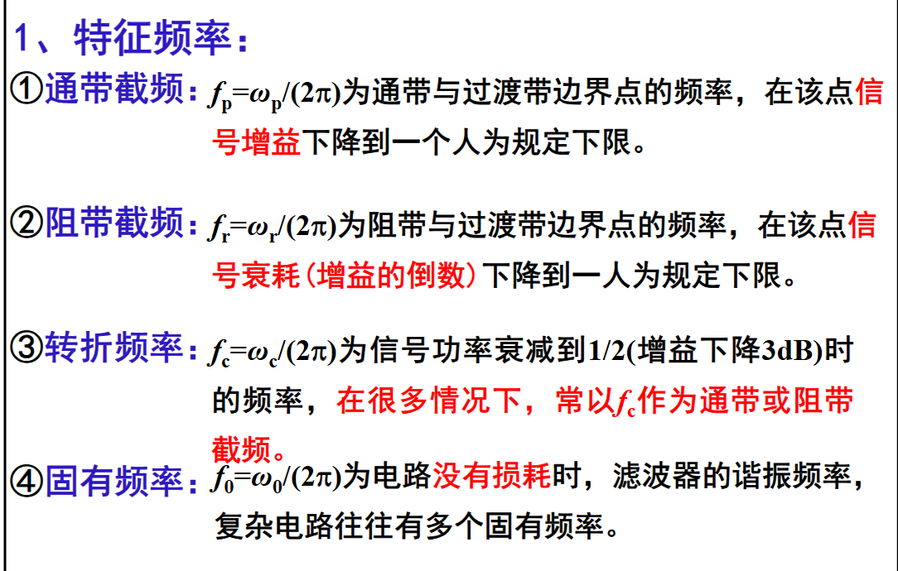
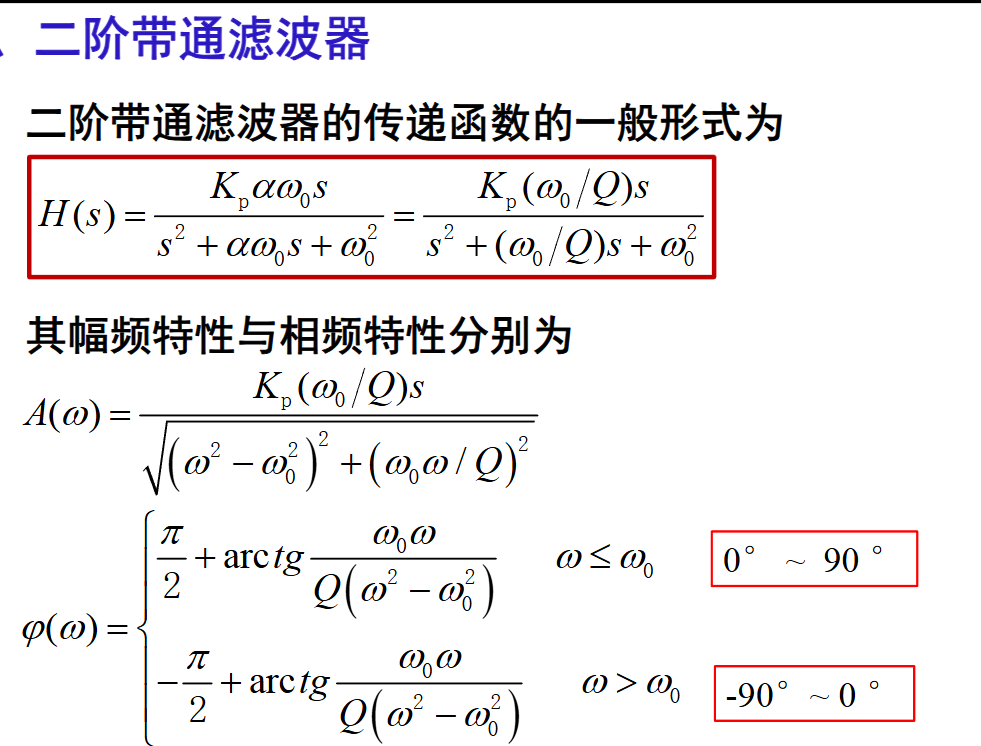
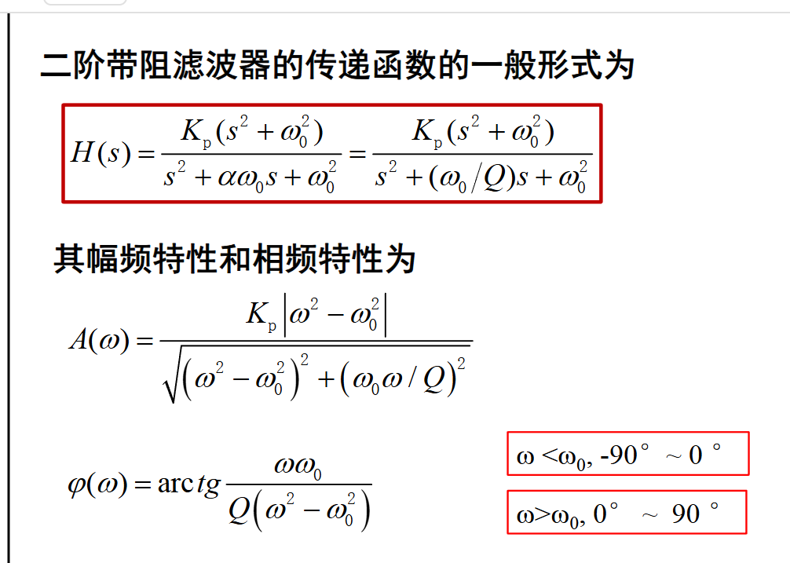
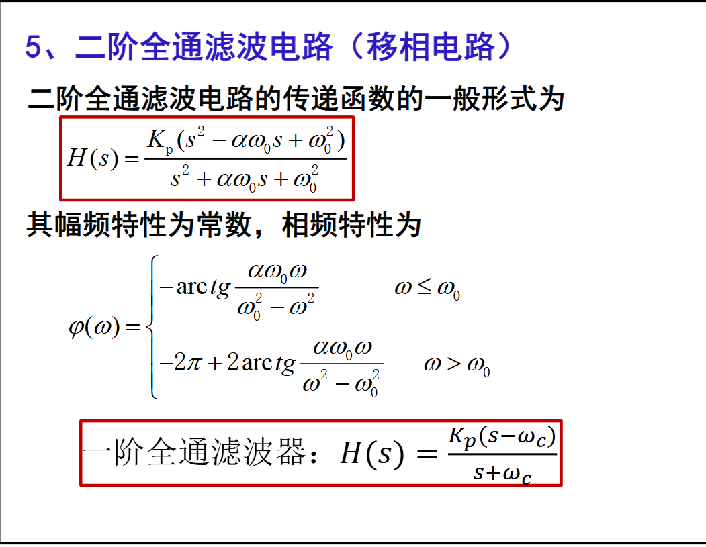

| 类型                    | 同向放大器                                                                                              | 反向放大器                                                                                  |
| --------------------- | -------------------------------------------------------------------------------------------------- | -------------------------------------------------------------------------------------- |
| 输入电阻 $R_\mathrm{in}$  | $\displaystyle 2R_\mathrm{cm} \parallel \frac{GR_\mathrm{i}}{1+\frac{R_\mathrm{F}}{R_\mathrm{A}}}$ | $R_\mathrm{A}$                                                                         |
| 输出电阻 $R_\mathrm{out}$ | $\displaystyle \frac{R_0}{1+\frac{R_\mathrm{A}G}{R_\mathrm{A}+R_\mathrm{F}}}$                      | $\displaystyle \frac{R_0}{1+\frac{R_\mathrm{A}G}{R_\mathrm{A}+R_\mathrm{F}}}$          |
| 带宽 $\mathrm{BW}$      | $\displaystyle \frac{\mathrm{GBP}}{1+\frac{R_\mathrm{A}G}{R_\mathrm{A}+R_\mathrm{F}}}$             | $\displaystyle \frac{\mathrm{GBP}}{1+\frac{R_\mathrm{A}G}{R_\mathrm{A}+R_\mathrm{F}}}$ |
| 增益                    | $\displaystyle 1+\frac{R_\mathrm{F}}{R_\mathrm{A}}$                                                | $\displaystyle -\frac{R_\mathrm{F}}{R_\mathrm{A}}$                                     |
|                       |                                                                                                    |                                                                                        |

---

| 参数符号                    | 物理含义                                                             | 741 典型数值       |
| :---------------------- | :--------------------------------------------------------------- | :------------- |
| $R_\text{cm}$           | 共模输入电阻，表征运放输入端对共模电压信号（两端同步变化的电压）呈现的等效对地阻抗，反映输入级对共模信号的阻碍能力        | 约200MΩ（双端共模定义） |
| $G$（开环增益 $A_\text{OL}$） | 开环差模电压增益，运放无外部负反馈时，输出电压与差模输入电压的比值，是运放本身的固有放大能力                   | $$10^{5} $$    |
| $\text{GBP}$（增益带宽积）     | 增益带宽积，运放开环增益与其对应-3dB带宽的乘积；闭环工作时，闭环增益与闭环带宽的乘积近似等于该常数，是运放频率特性的核心指标 | $$10^{6} $$    |

