一、所有的器件均为理想器件
（1）设$R_{1}= R_{4}= R_{A}$  , $R_{2}= R_{3}= R_{B}$ , 求差模增益$K_{d}$.
（2）$R_{1}= 99k\Omega$，$R_{2}=R_{3}=R_{4}= 100k\Omega$，$R_{G}= 20k\Omega$，求$CMRR$.
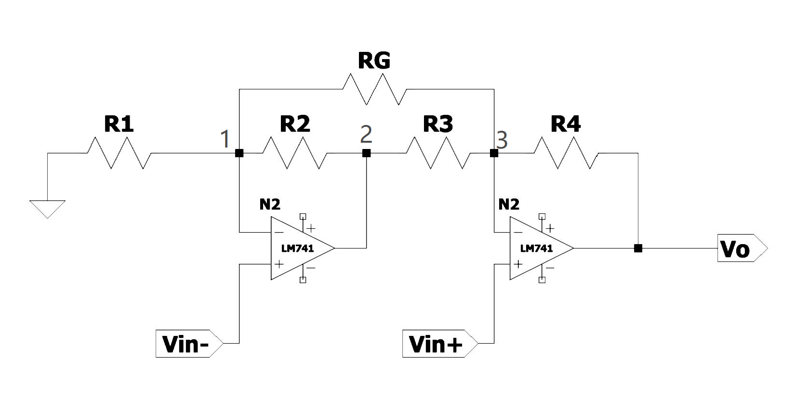$\begin{cases}在点1处：U_{1}\cdot(\frac{1}{R_{1}}+\frac{1}{R_{2}}+\frac{1}{R_{G}})-\frac{U_{3}}{R_{G}}-\frac{U_{2}}{R_{2}}=0\\在点2处：U_{3}(\frac{1}{R_{4}}+\frac{1}{R_{3}}+\frac{1}{R_{G}})-\frac{U_{3}}{R_{3}}-\frac{U_{1}}{R_{G}}-\frac{V_{O}}{R_{4}}=0\\U_{1}=V_{IN-},U_{3}=V_{IN+}&\end{cases}$
$$得：V_o=V_{in+}\left[1+\frac{R_4}{R_3}+\frac{R_4}{R_G}+\frac{R_2R_4}{R_3R_G}\right]-V_{in-}\left[\frac{R_4}{R_G}+\frac{R_4}{R_3}+\frac{R_2R_4}{R_3R_1}+\frac{R_2R_4}{R_3R_G}\right]$$
代入$V_{in+}=V_c+\frac{V_d}{2},V_{in-}=V_c-\frac{V_d}{2}$，得$$V_o=V_c\left[1-\frac{R_2R_4}{R_1R_3}\right]+\frac{V_d}{2}\left[1+\frac{2R_4}{R_3}+\frac{2R_4}{R_G}+\frac{R_2R_4}{R_1R_3}+\frac{2R_2R_4}{R_3R_G}\right].$$
（1）代入$R_{1}= R_{4}= R_{A}$  , $R_{2}= R_{3}= R_{B}$ 得
$$\begin{aligned}V_o=\frac{V_d}{2}\left(1+\frac{R_A}{R_B}+2\frac{R_A}{R_G}+1+\frac{R_A}{R_B}+2\frac{R_A}{R_G}\right)=V_d\left(1+\frac{R_A}{R_B}+2\frac{R_A}{R_G}\right)\end{aligned}$$$$差模增益为：K_d=1+\frac{R_A}{R_B}+2\frac{R_A}{R_G}$$
（2）代入$R_{1}= 99k\Omega$，$R_{2}=R_{3}=R_{4}= 100k\Omega$，$R_{G}= 20k\Omega$
得$$V_o=-\frac{V_c}{99}+-\frac{V_d\left(12\times 99\times 2+1 \right)}{99\times 2}$$
$$\mathrm{CMRR}=\left|\frac{K_{d}}{K_{c}}\right|=\frac{2377}{2}=1188.5$$
$$\mathrm{CMRR_{dB}=20\lg(1188.5)\approx61.5~dB}$$
二、所有器件都是理想器件
（1）求输入电阻$R_{i}$，输出$v_{o}$，截止频率
（2）怎样提高输入阻抗？画出相关电路

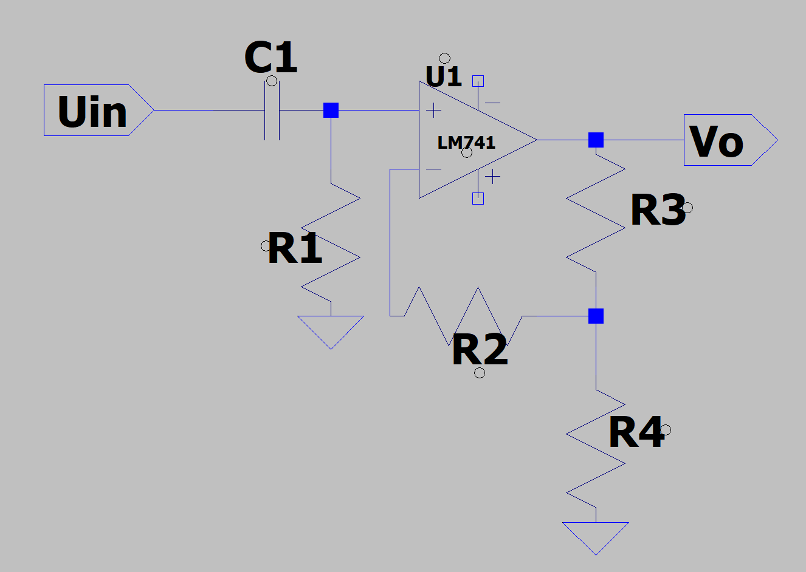
(1) 
输入电阻 $R_i$
从中频段看，$C_1$ 可视为短路，输入电阻即电阻 $R_1$：
$$R_i = R_1$$
（若计及频率特性，输入阻抗为 $Z_i = R_1 + \frac{1}{j\omega C_1}$）
输出电压 $v_o$
$$
v_o = U_{in} \cdot \frac{s R_1 C_1}{1 + s R_1 C_1} \cdot \left(1 + \frac{R_3}{R_4}\right)$$
中频增益为 $A_v = 1 + \frac{R_3}{R_4}$。
截止频率
电路为一阶高通滤波器，下限截止频率为：
$$f_L = \frac{1}{2\pi R_1 C_1}$$
（2）不会

三、（1）忽略电容C，$\text{取}R_1=R_2=R_4=R_3^{\prime}=2R_3$，分析${U}_{\mathbf{c}}$分别为高低电平时${\mathbf{V}_{1}}$与${\mathbf{V}_{2}}$的通断情况，分析${u}_{A}$、${u}_{}$、${u}_{s}$三者的关系
（2）这个电路是什么名字，有什么作用？
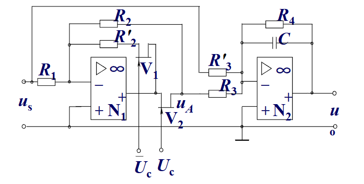（1）当${U}_{\mathbf{c}}$为逻辑高电平，$V_2\textbf{导 通 , }V_1$截止，$u_A=- \frac {R_2}{R_1}u_s= - u_s$ , $u_o= - \frac {R_4}{R_3^{\prime }}u_s- \frac {R_4}{R_3}u_A= \frac {R_4}{2R_3}u_s=u_s$ ;

当 $\dot{U} _{\mathbf{c} }$为 低 电 平 , $\boldsymbol{V}_{1}$导 通 , $\dot{V} _{2}$截 止 , $\boldsymbol{u}_{A}= \mathbf{0}$,$u_o=-\frac{R_4}{2R_3}u_s=-u_s;$
（2）精密整流型相敏检波电路
作用：PPT原话，不确定正确性
我们一般将相敏检波电路中的开关器件视为理想开关器件，比如开关式全波相敏检波电路中，MOS管导通时的等效内阻和截止漏电流，相加式相敏检波电路则假定开关器件的导通内阻为常量，且忽略其截止漏电流，这些都会引入误差，仿照精密检波电路，将其中的二极管用受参考信号$U_{\mathfrak{c}}$和$\overline U_{\mathfrak{c}}$控制的开关器件${\mathbf{V}_{1}}$与${\mathbf{V}_{2}}$代替，从而引入精密相敏检波电路。

四、（1）求$H(S)$
（2）这个微分电路为什么不实用？
（3）加一个电阻，使其变成实用微分电路，画出电路图并求$H(S)$

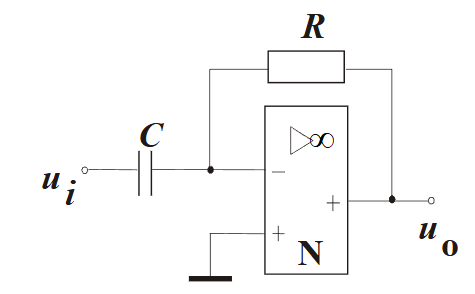
（1）
$H(S)=-RCs$
（2）微分只反映信号的变化速度，当信号无变化时，输出为零。无法克服静差
（3）在C左边加一个$R_{1}$,$H(s)=\frac{RCs}{R_{1}Cs+1}$
五、滞回比较器，已知$U_R=3V$,$U_{o}=\pm 12V$，$R_1=20K\Omega,R_2=10K\Omega$
（1）求阈值电压、滞回电压
（2）画出滞回曲线
（3）已知$u_i$毛刺波形，画出$U_o$
（4）$U_R=0V$，$R_1=49K\Omega,R_2=1K\Omega$，重新计算阈值电压和滞回电压
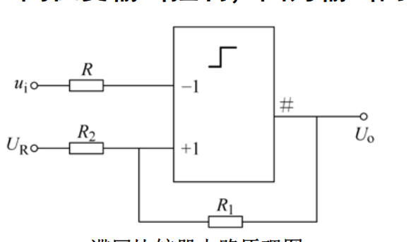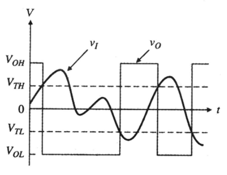
（1）$\mathrm{U}_{1}=\mathrm{U}_{\mathrm{R}}\frac{\mathrm{R}_{1}}{\mathrm{R}_{1}+\mathrm{R}_{2}}+\mathrm{U}_{\mathrm{oL}}\frac{\mathrm{R}_{2}}{\mathrm{R}_{1}+\mathrm{R}_{2}}=-2V; \mathrm{U}_{2}=\mathrm{U}_{\mathrm{R}}\frac{\mathrm{R}_{1}}{\mathrm{R}_{1}+\mathrm{R}_{2}}+\mathrm{U}_{\mathrm{oH}}\frac{\mathrm{R}_{2}}{\mathrm{R}_{1}+\mathrm{R}_{2}}=6V$
滞回电压为$\Delta U=8V$
（2）U1是-2V，挪一下
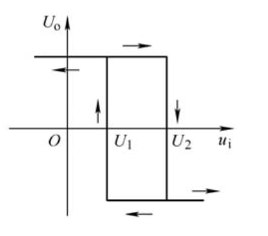
（3）懒得写了
六、（1）解释电路工作原理
（2）计算频率
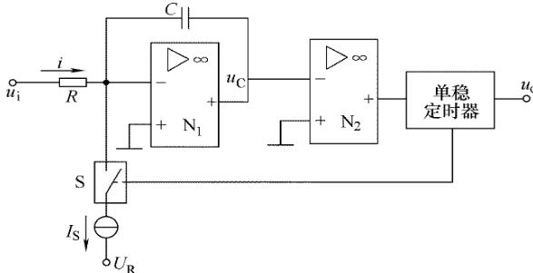
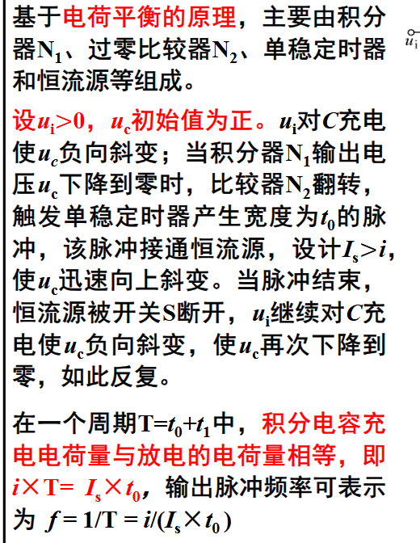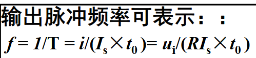

七、电阻链二倍频细分电路
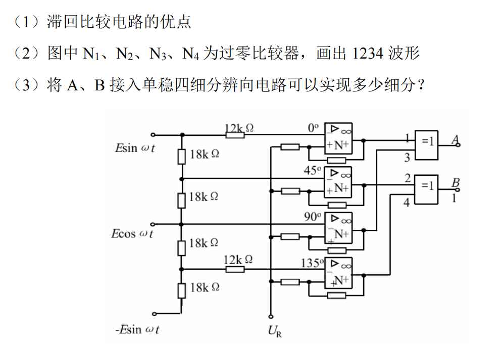（1）抗噪声干扰，消除抖动，避免“振铃”现象的出现
（2）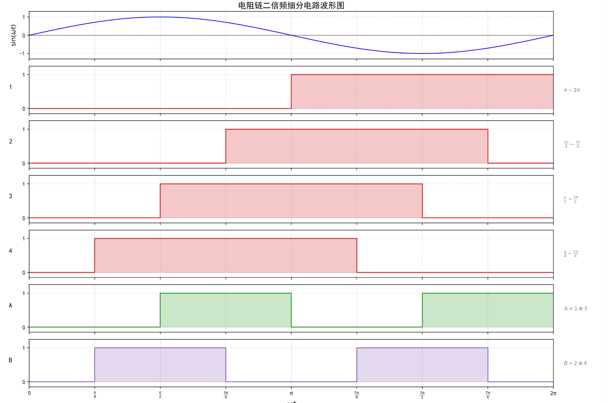
（3）
电阻链二倍频细分电路先对原始信号做了 2 倍频（一个原始周期内产生 2 个新周期），单稳四细分辨向电路又在其每个（倍频后的）周期内提取 4 个跳变沿产生 4 个计数脉冲，二者级联为乘积关系，故总细分数 = 2 × 4 = 8
八、两道题选择一道题即可1️⃣（1）写出低通二阶滤波器的$H(s)$
答：$$H(s)=\frac{K_{\mathrm{p}}\omega_{0}^{2}}{s^{2}+\alpha\omega_{0}s+\omega_{0}^{2}}$$
(2)制作一个二阶滤波器，要求稳定，使用什么类别？画出电路图
答：无限增益多路反馈型滤波电路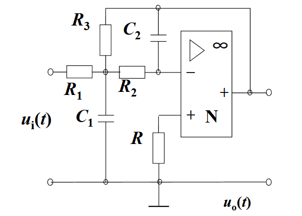
（3）要求$\alpha=\sqrt{2}$，应该使用什么逼近方式？
答：巴特沃斯逼近
（4）制作二阶高通滤波器，要求增益可调，使用什么类别？画出电路图
答：使用压控电压源型滤波电路
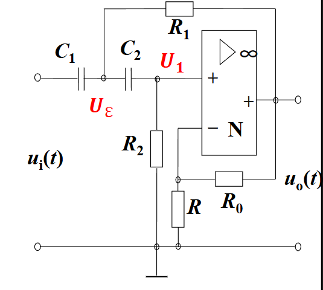
2️⃣制作一个切比雪夫逼近的滤波器，题目难以溯源